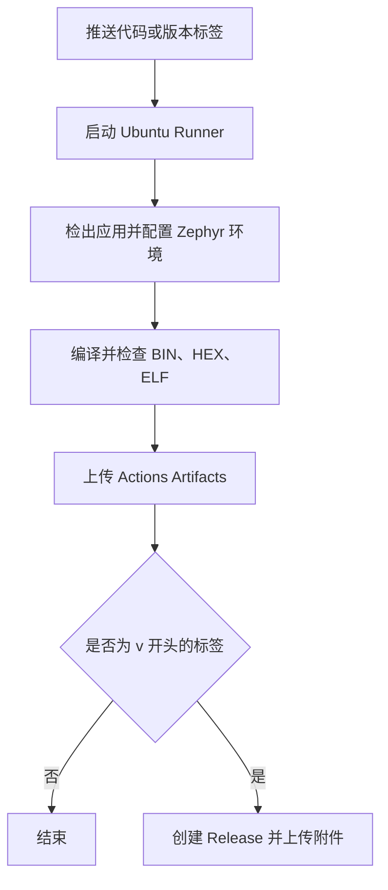

# 从 GitHub Actions 入门到 Zephyr 固件自动发布

本仓库是一个可以复制使用的学习例子：将 Zephyr 应用提交到 GitHub，自动编译出
BIN、HEX、ELF，再通过版本标签自动发布到 GitHub Releases。

当前目标是 `qemu_x86`，构建无需连接开发板。CI 当前执行编译、产物检查和发布，
没有启动 QEMU 运行程序；生成的文件针对 QEMU x86，实际硬件需要使用对应的构建目标。

## 目录

1. [学习目标与已验证结果](#1-学习目标与已验证结果)
2. [仓库结构和基本概念](#2-仓库结构和基本概念)
3. [第一个简单的 Actions 工作流](#3-第一个简单的-actions-工作流)
4. [准备 Zephyr 应用和依赖清单](#4-准备-zephyr-应用和依赖清单)
5. [完整工作流：构建、上传与发布](#5-完整工作流构建上传与发布)
6. [一步一步提交和构建](#6-一步一步提交和构建)
7. [使用 Tag 自动发布 Release](#7-使用-tag-自动发布-release)
8. [下载固件与私有仓库权限](#8-下载固件与私有仓库权限)
9. [每次构建会重新下载什么](#9-每次构建会重新下载什么)
10. [如何复用为新项目模板](#10-如何复用为新项目模板)
11. [常见问题](#11-常见问题)
12. [建议完成的一次练习](#12-建议完成的一次练习)
13. [官方参考资料](#13-官方参考资料)

## 1. 学习目标与已验证结果

完成这份教程后，可以独立完成以下操作：

- 编写一个由 push 触发的简单工作流。
- 使用官方 Action 配置 Zephyr 编译环境。
- 指定 Zephyr 版本、SDK、工具链和构建目标。
- 在 Actions 页面下载构建产物。
- 推送版本标签，自动创建 Release 并上传固件附件。
- 复制本仓库，为新的 Zephyr 项目调整配置。

本仓库已经验证过完整流程：

| 项目 | 已验证的配置或结果 |
| --- | --- |
| Runner | Ubuntu 24.04 |
| Python | 3.12 |
| Zephyr SDK | 1.0.1 |
| Zephyr 源码 | 4.4.99 开发版，固定到下方提交 |
| Zephyr 提交 | `434233e9751e7cca7bea82047e812bca607722d3` |
| 构建目标 | `qemu_x86` |
| 工具链 | `x86_64-zephyr-elf` |
| 发布附件 | `zephyr.bin`、`zephyr.hex`、`zephyr.elf` |
| 测试标签 | `v0.0.0-test.20261101.1` |

[测试构建记录](https://github.com/GR-X/action_test/actions/runs/41279663357)
和[测试版 Release](https://github.com/GR-X/action_test/releases/tag/v0.0.0-test.20261101.1)
已经生成。HEX 附件也完成过实际下载及 Intel HEX 记录长度、校验和检查。

上述链接属于本仓库。复制为新仓库后，应查看新仓库自己的 Actions 和 Releases。

## 2. 仓库结构和基本概念

```text
action_test/
├── .github/
│   └── workflows/
│       └── build.yml        # 当前实际运行的工作流
├── west.yml                 # 固定 Zephyr 版本并导入依赖
├── hello_world/
│   ├── CMakeLists.txt       # 定义应用和需要编译的源文件
│   ├── prj.conf             # Zephyr 应用配置
│   ├── README.rst           # 上游 Hello World 示例说明
│   ├── tests.yaml           # 上游示例的测试元数据
│   └── src/
│       └── main.c           # 应用入口
└── readme.md                # 本教程
```

| 名称 | 含义 | 本仓库中的例子 |
| --- | --- | --- |
| GitHub Actions | GitHub 提供的自动化平台 | 自动构建和发布固件 |
| Workflow | 一份完整的自动化流程，使用 YAML 描述 | `.github/workflows/build.yml` |
| Event | 启动流程的事件 | `push`、`workflow_dispatch` |
| Job | 在指定 Runner 上执行的一组工作 | `jobs.build` |
| Runner | 执行工作流的机器 | `ubuntu-24.04` |
| Step | Job 中按顺序执行的一步 | 下载代码、配置 SDK、编译 |
| Action | 可以复用的步骤组件，通过 `uses:` 调用 | `actions/checkout@v6` |
| Artifact | 某次工作流保存的构建文件 | `hello-world-qemu-x86` 下载包 |
| Tag | 标记某个 Git 提交的版本名称 | `v0.1.0` |
| Release | 关联 Tag 的发行记录，可以附加二进制文件 | 带 HEX 附件的版本发布页 |

工作流文件必须放在仓库根目录下的 `.github/workflows/`，并使用 `.yml` 或 `.yaml`
扩展名。只把 `build.yml` 放在仓库根目录，GitHub 不会将它识别为工作流。

本仓库当前的执行路径如下：



## 3. 第一个简单的 Actions 工作流

下面是一个独立的入门示例。它用于理解语法；本仓库实际运行的是第 5 节的
`build.yml`，不需要为了编译固件再添加这份演示工作流。

### 3.1 新建工作流文件

如果要练习，可以新建 `.github/workflows/learn-actions.yml`，写入：

```yaml
name: Learn GitHub Actions

"on":
  push:
  workflow_dispatch:

permissions:
  contents: read

jobs:
  hello:
    runs-on: ubuntu-24.04
    steps:
      - name: Check out repository
        uses: actions/checkout@v6

      - name: Say hello
        run: |
          echo "Hello GitHub Actions"
          echo "Repository: $GITHUB_REPOSITORY"
          echo "Ref: $GITHUB_REF_NAME"

      - name: List repository files
        run: ls -la
```

### 3.2 理解配置

- `name`：在 Actions 页面显示的工作流名称。
- `"on".push`：收到 push 事件时启动；当前没有分支或标签过滤，因此两者都会触发。
- `workflow_dispatch`：允许在 Actions 页面手动运行。该入口需要工作流存在于默认分支。
- `permissions.contents: read`：这个演示只读取仓库内容。
- `runs-on`：选择执行命令的 Runner 操作系统。
- `uses`：调用可复用的 Action，`@v6` 表示所使用的版本引用。
- `run`：在 Runner 上执行命令。本例是 Ubuntu，命令使用 shell 语法。
- `run: |`：后面缩进的多行内容属于同一个脚本。

YAML 使用空格缩进，注意同级字段对齐。`"on"` 加引号仍是正常的 GitHub Actions
语法，也可以避免部分 YAML 1.1 工具把 `on` 当成布尔值。

### 3.3 提交并观察结果

在仓库根目录执行：

```powershell
git add -- .github/workflows/learn-actions.yml
git commit -m "ci: add a simple Actions example"
git push origin main
```

进入仓库的 **Actions → Learn GitHub Actions → 对应运行记录 → hello**。
展开步骤，应该能看到问候文字、仓库名、分支名以及文件列表。

只修改文件或执行 `git commit` 不会触发 GitHub 云端构建，需要 `git push`。

## 4. 准备 Zephyr 应用和依赖清单

云端构建与本地使用相同的 Zephyr 构建系统，但运行在另一台机器上。
本机的 `D:\zephyrproject`、SDK 安装目录和 Windows 用户环境变量不会自动传到 Runner。
工作流需要自行准备源码、依赖和 SDK。

### 4.1 应用入口

本仓库的 [hello_world/src/main.c](hello_world/src/main.c) 来自官方 Hello World 示例：

```c
#include <stdio.h>

int main(void)
{
    printf("Hello World! %s\n", CONFIG_BOARD_TARGET);
    return 0;
}
```

程序运行时打印当前目标的名称。这里展示的是核心代码，完整源文件保留了上游版权和许可证声明。

### 4.2 CMake 工程

[hello_world/CMakeLists.txt](hello_world/CMakeLists.txt) 内容如下：

```cmake
# SPDX-License-Identifier: Apache-2.0

cmake_minimum_required(VERSION 3.28.0)

find_package(Zephyr REQUIRED HINTS $ENV{ZEPHYR_BASE})
project(hello_world)

target_sources(app PRIVATE src/main.c)
```

`find_package` 接入 Zephyr 构建系统，`target_sources` 列出应用需要编译的源文件。
以后添加自己的 `.c` 文件时，也要将相应源文件加入工程。

### 4.3 启用 BIN 和 HEX 输出

在 [hello_world/prj.conf](hello_world/prj.conf) 中设置：

```ini
CONFIG_BUILD_OUTPUT_BIN=y
CONFIG_BUILD_OUTPUT_HEX=y
```

本例生成的主要文件为：

| 文件 | 用途 |
| --- | --- |
| `zephyr.bin` | 原始二进制映像，使用时需结合目标的加载地址 |
| `zephyr.hex` | 带地址信息的 Intel HEX 文件 |
| `zephyr.elf` | 包含符号等信息的 ELF 文件，用于运行和调试等场景 |

输出文件对应所选择的构建目标。QEMU x86 的输出不能直接作为任意 STM32、Nordic 等
开发板的固件使用。当前普通单镜像构建将这些文件写入 `build/zephyr/`。

### 4.4 用 west.yml 固定 Zephyr 版本

仓库根目录的 [west.yml](west.yml) 为：

```yaml
manifest:
  projects:
    - name: zephyr
      url: https://github.com/zephyrproject-rtos/zephyr
      # Zephyr 4.4.99, matching the local workspace used for this application.
      revision: 434233e9751e7cca7bea82047e812bca607722d3
      import: true
  self:
    path: app
```

- `url`：Zephyr 源码仓库地址。
- `revision`：使用哪个源码版本，可以填写 tag 或提交哈希。
- `import: true`：导入该版本 Zephyr 自带的模块依赖清单。
- `self.path: app`：本模板约定应用仓库在 West 工作区中位于 `app/`。

Zephyr 版本和 SDK 版本分别控制源码与编译工具，是两个独立的配置。
本例固定已验证的组合；更换 Zephyr 时，应同时检查 SDK 兼容性。

## 5. 完整工作流：构建、上传与发布

当前实际生效的文件是 [.github/workflows/build.yml](.github/workflows/build.yml)。
下面给出完整内容，可以与仓库中的实际文件对照学习：

```yaml
name: Zephyr Hello World

"on":
  push:
  workflow_dispatch:

permissions:
  contents: write

jobs:
  build:
    runs-on: ubuntu-24.04
    timeout-minutes: 45
    steps:
      - name: Check out application
        uses: actions/checkout@v6
        with:
          path: app

      - name: Set up Python
        uses: actions/setup-python@v6
        with:
          python-version: "3.12"

      # https://github.com/zephyrproject-rtos/action-zephyr-setup
      - name: Set up Zephyr
        uses: zephyrproject-rtos/action-zephyr-setup@v1
        with:
          app-path: app
          sdk-version: "1.0.1"
          toolchains: x86_64-zephyr-elf

      - name: Build Hello World
        run: west build -b qemu_x86 app/hello_world -d build

      - name: Check firmware outputs
        run: |
          test -s build/zephyr/zephyr.bin
          test -s build/zephyr/zephyr.hex
          test -s build/zephyr/zephyr.elf

      - name: Upload firmware
        uses: actions/upload-artifact@v7
        with:
          name: hello-world-qemu-x86
          path: |
            build/zephyr/zephyr.bin
            build/zephyr/zephyr.hex
            build/zephyr/zephyr.elf
          if-no-files-found: error
          retention-days: 14

      - name: Publish release
        if: startsWith(github.ref, 'refs/tags/v')
        shell: bash
        env:
          GH_TOKEN: ${{ secrets.GITHUB_TOKEN }}
        run: |
          release_flags=(--latest)
          if [[ "$GITHUB_REF_NAME" == *-* ]]; then
            release_flags=(--prerelease --latest=false)
          fi
          gh release create "$GITHUB_REF_NAME" \
            build/zephyr/zephyr.hex \
            build/zephyr/zephyr.bin \
            build/zephyr/zephyr.elf \
            --repo "$GITHUB_REPOSITORY" \
            --verify-tag \
            --title "$GITHUB_REF_NAME" \
            --generate-notes \
            "${release_flags[@]}"
```

### 5.1 下载代码和配置环境

`actions/checkout` 将整个仓库下载到 `app/`。官方 `action-zephyr-setup` 从该目录的
`west.yml` 初始化 West 工作区，获取 Zephyr 和模块，安装 Python 依赖并配置 SDK。

本模板使用 GitHub 托管的 Ubuntu Runner，其中已提供 CMake、Ninja、GitHub CLI 等
构建所需工具；迁移到自己维护的 Runner 时，需要自行准备这些工具。

云端目录关系大致为：

```text
工作目录/
├── .west/                    # West 工作区信息
├── app/                      # actions/checkout 检出的本仓库
│   ├── west.yml
│   └── hello_world/
├── zephyr/                   # 从上游获取的 Zephyr 源码
├── modules/                  # 依赖模块
├── zephyr-sdk/               # 官方 Action 配置的 SDK
└── build/
    └── zephyr/               # 最终固件文件
```

注意 `app-path: app` 指向包含 `west.yml` 的仓库目录，
`app/hello_world` 才是本次实际编译的应用目录。

### 5.2 编译和检查产物

核心编译命令：

```sh
west build -b qemu_x86 app/hello_world -d build
```

| 参数 | 含义 |
| --- | --- |
| `-b qemu_x86` | 选择构建目标 |
| `app/hello_world` | 选择应用源码目录 |
| `-d build` | 设置构建输出目录 |

`test -s` 要求文件存在且非空。检查分别针对三个文件执行，可以避免只有部分文件生成时
仍继续发布。当前流程顺序执行，前面的编译、检查或上传步骤失败，后续发布步骤不会运行。

### 5.3 上传 Actions Artifacts

`actions/upload-artifact` 上传指定的三个文件，默认打包下载。

- `name`：在 Actions 页面显示的产物名称，不会重命名内部固件文件。
- `path`：需要上传的文件路径，相对工作目录解析。
- `if-no-files-found: error`：没有找到上传文件时让步骤失败。
- `retention-days: 14`：本例将 Artifacts 保留 14 天。

### 5.4 创建 Release 并上传附件

发布需要三个条件：前面的步骤成功、当前引用是 Tag、Tag 名以 `v` 开头。
其中标签条件由以下表达式控制：

```yaml
if: startsWith(github.ref, 'refs/tags/v')
```

发布使用 Runner 中的 GitHub CLI：

| 配置或参数 | 作用 |
| --- | --- |
| `permissions.contents: write` | 允许工作流在当前仓库创建 Release、上传附件 |
| `GH_TOKEN` | 把自动提供的 `GITHUB_TOKEN` 交给 GitHub CLI 使用 |
| `$GITHUB_REF_NAME` | 本次 Tag 的名称，例如 `v0.1.0` |
| `$GITHUB_REPOSITORY` | 当前仓库，例如 `GR-X/action_test` |
| `--repo` | 明确发布到哪个仓库，避免依赖当前目录是否为 Git 仓库 |
| `--verify-tag` | 要求远端已存在该 Tag，避免自动从其他提交创建标签 |
| `--generate-notes` | 生成版本说明 |
| `--latest` | 将正式发行记录设为 Latest |
| `--prerelease --latest=false` | 标为测试版，并且不设为 Latest |

对于本仓库这种发布到自身仓库的场景，使用自动提供的 `GITHUB_TOKEN` 即可，
无需自己新建个人访问令牌 Secret。

## 6. 一步一步提交和构建

### 6.1 准备条件

1. 有本仓库或新项目仓库的推送权限。
2. 本机安装 Git，并能正常执行 `git push`。
3. 仓库的 **Settings → Actions → General** 允许工作流及所使用的 Actions 运行。
4. 将应用、`west.yml` 和工作流提交到仓库。

只在 GitHub 上构建时，本机无需安装 Zephyr SDK。需要在本地编译时再配置本地工具链。

从头练习可以先克隆仓库，选择不带空格的本地目录：

```powershell
git clone https://github.com/GR-X/action_test.git action-test
Set-Location .\action-test
```

已有当前仓库的本地副本时，直接使用现有副本，不需要重复克隆。

### 6.2 修改应用并提交

例如修改 `hello_world/src/main.c` 中打印的文字，然后在仓库根目录执行：

```powershell
git status
git add -- hello_world .github/workflows/build.yml west.yml readme.md
git commit -m "feat: update hello world firmware"
git push origin main
```

按实际改动选择 `git add` 的路径，不要把 SDK、依赖模块或本地构建目录提交到应用仓库。

### 6.3 查看构建

进入 **Actions → Zephyr Hello World → 对应提交的运行记录 → build**。
依次查看 `Set up Zephyr`、`Build Hello World`、`Check firmware outputs` 和
`Upload firmware`。普通分支 push 时，`Publish release` 显示跳过是正常的。

成功后，在运行记录的 **Artifacts** 区域下载 `hello-world-qemu-x86`。

也可以在 **Actions → Zephyr Hello World → Run workflow** 中选择分支手动构建。
手动构建默认分支不会因为按钮被点击而自动变成一次版本发布，发布条件仍检查当前引用。

## 7. 使用 Tag 自动发布 Release

Tag 标记某个已提交的代码版本；Release 是关联该 Tag 的发行记录。
仅推送 Tag 不会自动产生固件附件，本模板通过工作流完成编译、创建 Release 和上传附件。

### 7.1 先确认待发布的代码

```powershell
git status
git log -1 --oneline
```

先提交应用和工作流的改动，再打版本标签。下面示例的 Tag 应是尚未使用过的新名称。

### 7.2 发布测试版

```powershell
git tag -a v0.1.0-rc.1 -m "Release candidate 1"
git push origin v0.1.0-rc.1
```

推送后会再次构建该 Tag 对应的代码。所有前置步骤成功后，创建同名 Release，
上传 BIN、HEX、ELF，并标记为 **Pre-release**。

本模板检查 Tag 名是否含 `-`，例如 `v0.1.0-rc.1`、`v0.1.0-test.1`。
这是发布脚本的命名约定，GitHub 不会仅因为名称带 `-` 就自动判断发行类型。

### 7.3 发布正式版

测试通过后，可以为确认过的提交发布正式版本：

```powershell
git tag -a v0.1.0 -m "Release v0.1.0"
git push origin v0.1.0
```

构建成功后，创建正式 Release 并设为 **Latest**。
后续代码有新变化时使用新版本号，例如 `v0.1.1`，使版本号和实际代码对应。

### 7.4 不同操作的结果

| 操作 | 编译 | 上传 Artifacts | 创建 Release |
| --- | --- | --- | --- |
| 普通分支 push | 是 | 是 | 否 |
| 推送 `v0.1.0-rc.1` | 是 | 是 | 测试版，不设为 Latest |
| 推送 `v0.1.0` | 是 | 是 | 正式版，设为 Latest |
| 手动运行默认分支 | 是 | 是 | 否 |

当前触发器没有限制分支和标签，因此一次推送同时更新分支与 Tag 时，可能触发两次运行。

## 8. 下载固件与私有仓库权限

### 8.1 下载 Actions 产物

路径为 **Actions → 对应运行记录 → Artifacts → hello-world-qemu-x86**。
这是某次构建的归档包，本模板设置保留 14 天。

### 8.2 下载 Release 附件

路径为 **仓库主页 → Releases → 对应版本 → Assets**。
展开 Assets 后，点击 `zephyr.hex`、`zephyr.bin` 或 `zephyr.elf` 即可单独下载。

Tag 列表主要用于查看标签和下载源码；编译后的固件附件应在相应 Release 页面查找。
GitHub 自动生成的 `Source code (zip)`、`Source code (tar.gz)` 也是源码归档。

Release 附件不使用工作流中 `retention-days: 14` 的 Artifacts 保留设置。

本仓库已发布的测试版 HEX：

[下载测试版 zephyr.hex](https://github.com/GR-X/action_test/releases/download/v0.0.0-test.20261101.1/zephyr.hex)

首次发布正式版后，可以使用固定的最新版入口：

[下载最新版 zephyr.hex](https://github.com/GR-X/action_test/releases/latest/download/zephyr.hex)

最新版入口要求存在正式 Latest Release，而且该 Release 上传了同名的 `zephyr.hex`。
仅存在测试版时，应使用对应测试版的下载链接。复制到新仓库后，还要替换链接中的仓库名称。

### 8.3 私有仓库的权限

私有仓库中的 Release 和固件附件仍受仓库访问权限控制：

- 浏览器下载：登录具有该仓库读取权限的 GitHub 账号。
- 命令行或 API 下载：使用具有相应仓库读取权限的认证信息。
- 没有仓库权限的用户访问链接时，可能看到 404 或无法下载。

直接下载链接可以减少寻找附件的步骤，但不会将私有固件变成公开文件。

## 9. 每次构建会重新下载什么

GitHub 托管 Runner 每次运行都是独立环境，官方环境配置 Action 会使用缓存加速准备和编译。

| 内容 | 当前配置下的行为 |
| --- | --- |
| 本仓库应用代码 | 每次检出本次提交 |
| Zephyr 和模块源码 | 执行 West 初始化和更新；本模板未额外配置源码缓存 |
| Zephyr SDK | 命中缓存时恢复，未命中时下载和配置 |
| Python 依赖 | 每次安装，可复用包下载缓存 |
| 编译过程 | 官方 Action 默认启用 ccache，命中时复用可用编译结果 |

首次构建、版本变化或缓存未命中时通常更慢。缓存有分支和引用等访问范围，
所以不能保证任意下一次运行都命中之前的缓存。

## 10. 如何复用为新项目模板

### 10.1 创建 GitHub 模板仓库

1. 在本仓库打开 **Settings**。
2. 勾选 **Template repository**。
3. 新建项目时，在仓库主页点击 **Use this template → Create a new repository**。
4. 填写新仓库名称，选择公开或私有，然后创建。

这会复制目录和文件。新仓库需要运行自己的工作流、发布自己的 Tag 和 Release。
有模板仓库读取权限的用户可以基于它创建新仓库。

### 10.2 换项目时修改哪些配置

| 目标 | 修改位置 | 示例 |
| --- | --- | --- |
| 换应用目录 | 仓库中的应用目录，以及 `west build` 的源码路径 | `app/hello_world` 改为 `app/my_app` |
| 添加应用源码 | 应用的 `CMakeLists.txt` | 将新的 `.c` 文件加入 `target_sources` |
| 换构建目标 | `west build -b` | 改为支持该项目的目标名称 |
| 换架构工具链 | `Set up Zephyr` 的 `toolchains` | ARM 使用 `arm-zephyr-eabi` |
| 换 SDK | `sdk-version` | 选与 Zephyr 版本兼容的 SDK |
| 换 Zephyr 版本 | `west.yml` 的 `revision` | 固定 tag 或完整提交哈希 |
| 换 Artifacts 包名 | `Upload firmware` 的 `name` | `my-app-firmware` |
| 改输出目录或文件名 | 编译、文件检查、Artifacts 上传、Release 上传的相应路径 | 四处保持一致 |
| 改 README 下载链接 | 本教程中的仓库和版本链接 | 替换为新仓库 |

`app-path: app` 指向 West 清单所在的仓库目录，不需要因为应用改名为 `my_app`
就一起改成 `my_app`。工作流中的 `$GITHUB_REPOSITORY` 会自动指向当前仓库，
因此复制模板后，发布命令通常不需要手动填写新的仓库名称。

### 10.3 一个不需要开发板的改配置练习

要将当前示例改为 ARM Cortex-M3 模拟目标，同时修改两处：

```yaml
toolchains: arm-zephyr-eabi
```

```sh
west build -b qemu_cortex_m3 app/hello_world -d build
```

选择真实开发板时，同样需要让目标、架构工具链及应用配置匹配。
这份教程针对当前普通单镜像构建；以后使用 sysbuild、引导程序或多镜像时，
还需要根据实际输出目录调整检查和上传路径。

## 11. 常见问题

| 现象 | 排查方法 |
| --- | --- |
| push 后完全没有工作流运行 | 检查 YAML 是否位于 `.github/workflows/`、是否提交并推送、Actions 是否启用，以及触发条件是否匹配 |
| Actions 没有手动运行按钮 | 检查默认分支中是否存在含 `workflow_dispatch` 的工作流 |
| `west: unknown command "build"` | 检查是否已初始化 West 工作区，以及工作目录或 `ZEPHYR_BASE` 能否定位到该工作区；CI 中确认先执行环境配置步骤 |
| 应用目录不存在 | 本仓库本地应用是 `hello_world/`，云端检出到 `app/` 后是 `app/hello_world/`；没有预先创建的 `apps/hello_world/` |
| 本地构建路径有空格 | Zephyr 不支持源码或构建路径包含空格，使用例如 `action-test` 的目录名 |
| 找不到 HEX | 检查 `CONFIG_BUILD_OUTPUT_HEX=y`、构建是否成功，以及 `build/zephyr/zephyr.hex` 是否存在 |
| Artifacts 下载有了，Release 没有 | 检查本次是否推送了 `v` 开头的 Tag，以及 `Publish release` 是跳过还是失败 |
| 发布出现 403 / Resource not accessible | 检查 `contents: write`、仓库与组织的 Actions 策略，以及发布目标是否仍为当前仓库 |
| 同名 Release 已存在 | 当前脚本使用 `gh release create`，不自动覆盖已有 Release；新改动使用新版本号，发布步骤重跑前先核对已有发行记录 |
| 在 Tag 页面找不到固件 | 打开对应的 Release，展开 Assets |
| 最新版下载入口找不到测试版 | 测试版设置了 `--latest=false`，使用该测试版的具体下载链接 |
| 私有仓库下载显示 404 | 确认已登录正确账号并具有仓库读取权限 |
| 有 ELF 但未看到 Hello World 运行输出 | 本工作流只编译和发布，没有启动 QEMU；需要额外运行模拟器才会执行程序 |

## 12. 建议完成的一次练习

1. 修改 `hello_world/src/main.c` 中的打印文字。
2. 提交并推送到 `main`，观察 Actions 的每个步骤。
3. 下载 Artifacts，确认存在 BIN、HEX、ELF，普通分支运行没有创建新 Release。
4. 给确认过的提交打一个新的测试标签，例如 `v0.1.0-rc.1`，并推送该标签。
5. 等待标签构建成功，在 Releases 页面找到 Pre-release，单独下载 HEX。
6. 给确认过的提交打正式标签，例如 `v0.1.0`，并推送。
7. 确认正式 Release 被设为 Latest，最新版 HEX 下载链接可以访问。
8. 复制模板到新仓库，修改应用路径或模拟目标，重复验证。

每个版本标签只用于对应的代码版本。前面示例中的名称已经被使用时，选择新的版本号。

## 13. 官方参考资料

- [GitHub：创建第一个工作流](https://docs.github.com/en/actions/tutorials/create-an-example-workflow)
- [Zephyr：官方环境配置 Action](https://github.com/zephyrproject-rtos/action-zephyr-setup)
- [Zephyr：Hello World 构建和运行](https://docs.zephyrproject.org/latest/samples/hello_world/README.html)
- [Zephyr：应用开发与路径限制](https://docs.zephyrproject.org/latest/develop/application/index.html)
- [Zephyr：BIN、HEX 输出配置定义](https://github.com/zephyrproject-rtos/zephyr/blob/main/Kconfig.zephyr)
- [GitHub：上传构建产物](https://github.com/actions/upload-artifact)
- [GitHub：工作流中的 GITHUB_TOKEN](https://docs.github.com/en/actions/tutorials/authenticate-with-github_token)
- [GitHub CLI：创建 Release 和上传附件](https://cli.github.com/manual/gh_release_create)
- [GitHub：Release 链接规则](https://docs.github.com/en/repositories/releasing-projects-on-github/linking-to-releases)
- [GitHub：创建模板仓库](https://docs.github.com/en/repositories/creating-and-managing-repositories/creating-a-template-repository)
